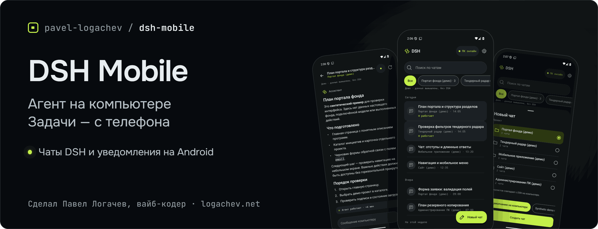
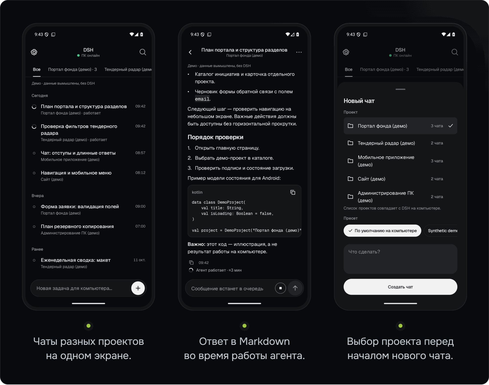
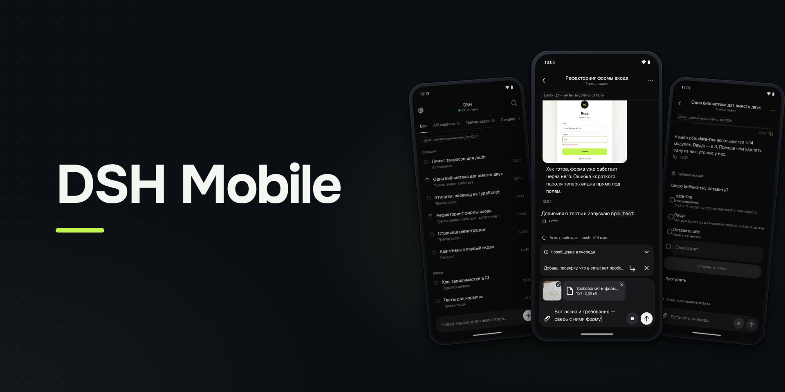
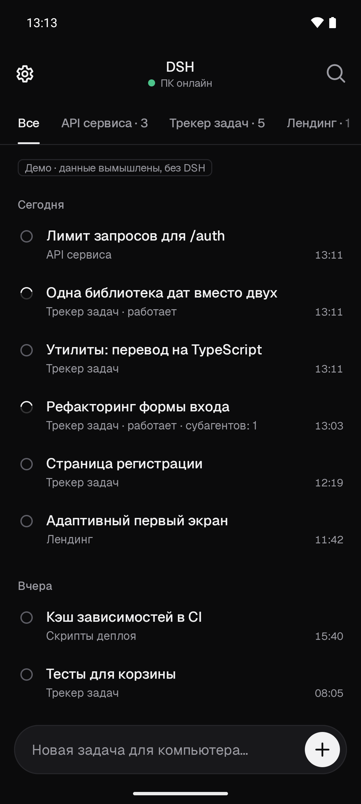
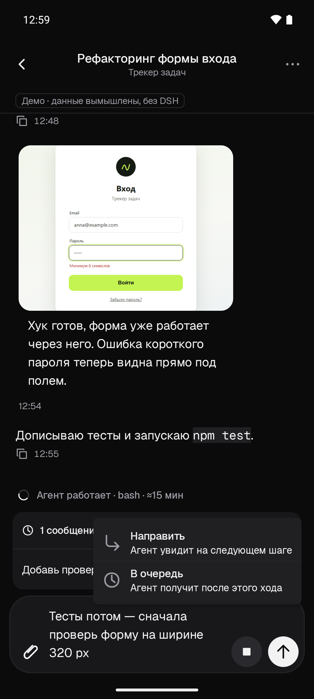
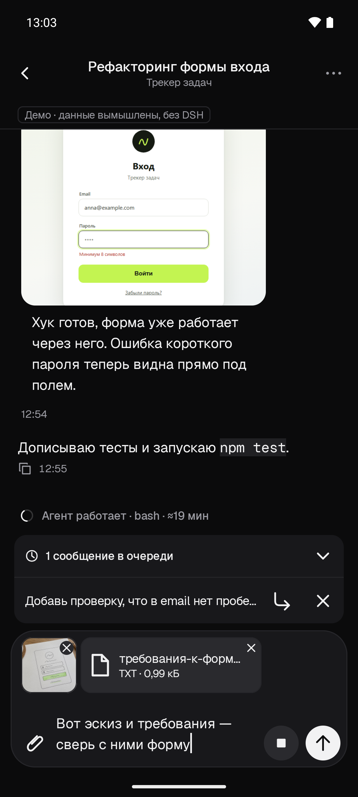
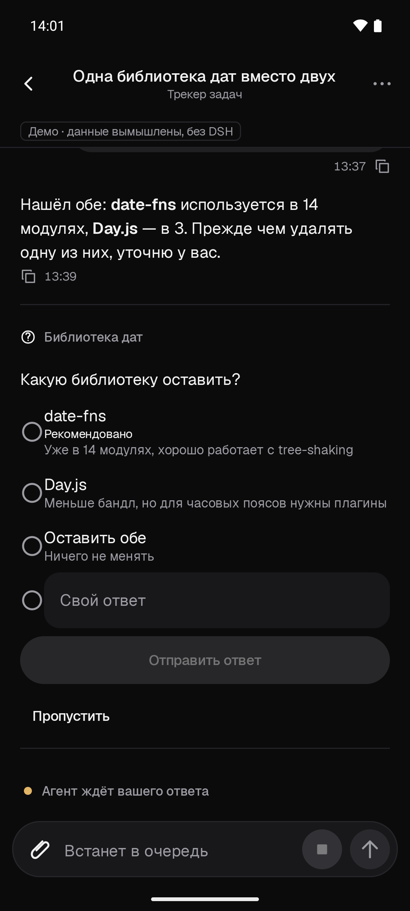
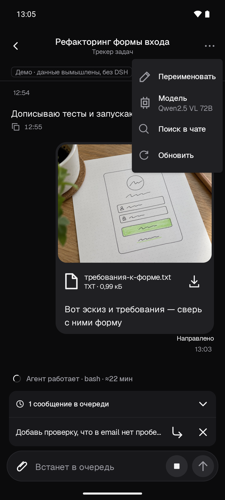
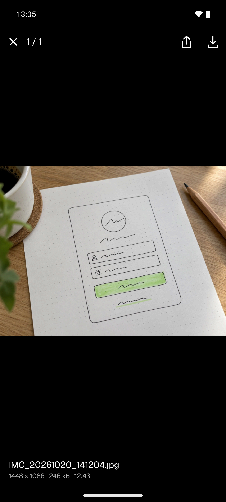
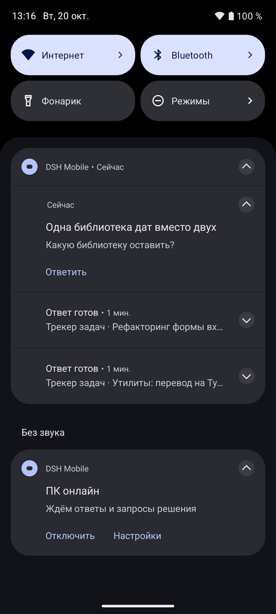

<picture><source media="(max-width: 767px)" srcset="docs/assets/dsh-mobile-banner-mobile.png"></picture>

# DSH Mobile

Кейс на сайте: <https://logachev.net/#case-dsh-mobile> · Статья в журнале: [DeepSeek Harness с телефона: как управлять агентом на компьютере с Android](https://logachev.net/journal/deepseek-harness-s-telefona-android/) · [Технический разбор на Хабре](https://habr.com/ru/articles/1099110/)

[](https://github.com/pavel-logachev/dsh-mobile/releases/latest) [](https://github.com/pavel-logachev/dsh-mobile/actions/workflows/ci.yml) [](<LICENSE>)

[English](README.md) | Русский

**Ваш агент [DeepSeek Harness](https://github.com/deepseek-ai/deepseek-harness) работает на компьютере. С Android-телефона вы ставите задачи с фото и файлами, читаете ответы в реальном времени, отвечаете на вопросы агента и получаете уведомление «Ответ готов».**

[Скачать APK 0.8.2](https://github.com/pavel-logachev/dsh-mobile/releases/tag/v0.8.2) · [Установка](#установка) · [Архитектура](#как-это-устроено) · [Безопасность](#безопасность)

> Неофициальный проект Павла Логачева. Разрабатывается независимо от DeepSeek.

Android 8.0+ · Привязка по QR-коду · Wi‑Fi или Tailscale

Модели, инструменты и подписки остаются на компьютере. Облачного сервера у DSH Mobile нет.

## Что можно делать с телефона

- **Открывать чаты всех проектов.** Искать чаты и фильтровать по проекту. Список проектов следует боковой панели DSH и обновляется без повторной привязки.
- **Ставить задачи.** Выбрать проект и пресет и сразу написать задачу: приложение создаст чат и отправит текст один раз.
- **Отправлять фото и файлы.** Снимок с камеры, фотографии через системный выбор фото (Photo Picker), файлы через системный выбор файлов. Загрузка начинается сразу после выбора. В одном сообщении — до 20 вложений общим объемом до 200 МиБ, каждый файл — до 20 МиБ. Изображения PNG, JPEG, WebP и GIF агент получает как изображения, файлы передаются в хранилище вложений DSH в момент отправки. Неотправленные загрузки истекают на компьютере через 10 минут и в DSH не попадают.
- **Читать ответ в реальном времени.** Markdown, таблицы, блоки кода с копированием. Изображения из сообщений видны прямо в переписке; по нажатию открывается полноэкранный просмотр, где картинку можно увеличить, отправить через «Поделиться» или сохранить. Файлы из сообщений можно скачать — до 20 МиБ. Служебные события свернуты в строку «Действия агента» — полный текст доступен по нажатию. Длинный сжатый чат, старую историю которого не удается восстановить в пределах ограничений, открывается с последними сообщениями и пометкой, что история обрезана.
- **Дописывать и направлять, пока агент работает.** По умолчанию сообщение встанет в очередь DSH и дойдет до агента в следующем ходе. «Направить» доставляет его на следующем шаге агента, не останавливая текущий ход: удерживайте кнопку отправки или нажмите ↳ у сообщения в очереди. Сообщение можно и убрать из очереди.
- **Отвечать на вопросы агента.** Выбрать один или несколько вариантов, написать свой ответ или пропустить вопрос. Вариант, который рекомендует агент, отмечен, но не выбран заранее. Подтверждения действий агента остаются на компьютере.
- **Переименовывать чат и менять его модель.** Оба действия — в меню ⋯. Новая модель применяется со следующего запроса к модели, возможно уже на следующем шаге идущего хода; запрос, который уже выполняется, не переключается.
- **Останавливать работу.** Отдельная кнопка «Стоп» запрашивает подтверждение.
- **Получать уведомления.** Для «Ответ готов» и «Агент ждет вашего решения» отдельно выбираются «Со звуком» (всплывающий баннер со звуком), «Без звука» или «Выключены». У каждого режима свой канал Android; в настройках приложения есть переходы к системным настройкам каналов. При обновлении прежний системный выбор сохраняется: выключенный канал остается выключенным, беззвучный — беззвучным. Звук сопровождает каждое новое событие, несколько оповещений группируются, а постоянное уведомление о связи — беззвучное. Уведомление о вопросе агента сразу открывает этот вопрос. Предупреждение «Часть событий могла быть пропущена» исчезает само, когда компьютер подтверждает полное восстановление без пропусков. Для открытого на экране чата уведомлений нет. Отдельные проекты и чаты можно отключить.
- **Возвращаться к переписке.** Поиск по сообщениям, черновик для каждого чата и копирование по долгому нажатию.

Вложения, «Направить», ответы на вопросы, переименование, смена модели, просмотр и скачивание файлов, а также новые возможности уведомлений требуют плагина-компаньона 0.7.0 или новее. Исправления задержек уведомлений и допуска отправки в текущем выпуске требуют плагина 0.7.2. Приложение показывает каждую новую функцию, только если подключенный плагин сообщает о ее поддержке.

Тема следует системной, светлую или темную можно выбрать вручную. Интерфейс на русском и английском: язык следует системному или выбирается в настройках приложения. Поддерживается крупный шрифт.

<picture><source media="(max-width: 767px)" srcset="docs/assets/dsh-mobile-screens-mobile.png"></picture>

Снимки сделаны в настоящем приложении с синтетическими демо-данными. Реальных чатов и подключенных моделей на них нет.

## Скриншоты



DSH Mobile 0.8: агент работает на компьютере, а чат с ним — у вас в телефоне.



Чаты всех проектов DSH в одном списке.



Агент работает, а вы дописываете: в очередь или «Направить» на следующем шаге.



Фото с камеры, снимки из галереи и файлы — в одном сообщении агенту.



Вопрос агента: выберите вариант, напишите свой ответ или пропустите.



Меню ⋯: переименование чата и смена модели.



Изображение из чата на весь экран: увеличить, поделиться, сохранить.



Уведомления: ответ готов, агент задал вопрос.

## Как это устроено

На компьютере устанавливается плагин-компаньон. Он открывает привязанному телефону узкий API через защищенное соединение, но не публикует наружу веб-интерфейс DSH.

```text
Android-приложение
  │ HTTPS по Wi‑Fi или Tailscale
  │ или через ваш собственный relay
  ▼
Плагин-компаньон внутри DSH
  │
  ▼
Ваши проекты и агенты на компьютере
```

Телефон — только клиент: агент продолжает работать и после закрытия приложения. Основная история переписки хранится в DSH на компьютере.

Android-клиент написан на Kotlin и Jetpack Compose, плагин работает на Node.js. Собственный relay — необязательный вариант подключения; общего публичного relay проект не предоставляет.

## Установка

Подробную [инструкцию установки](<docs/SETUP.md>) можно передать своему агенту DSH. В ней — проверки окружения, команды и отдельное согласование установки, прав доступа и активации.

1. **Проверьте требования.**

   Компьютер: Windows, DeepSeek Harness `0.2.0-rc.2` или `0.2.1-alpha.1`, Node.js 24.x, OpenSSL 3. Телефон: Android 8.0 или новее. Node 24 нужен и процессу DSH, внутри которого работает плагин, — одной подходящей версии в PATH недостаточно.

2. **Скачайте и проверьте файлы релиза.**

   Из [релиза 0.8.2](https://github.com/pavel-logachev/dsh-mobile/releases/tag/v0.8.2) нужны подписанный [dsh-mobile-0.8.2.apk](https://github.com/pavel-logachev/dsh-mobile/releases/download/v0.8.2/dsh-mobile-0.8.2.apk), архив плагина [dsh-mobile-host-0.7.2.zip](https://github.com/pavel-logachev/dsh-mobile/releases/download/v0.8.2/dsh-mobile-host-0.7.2.zip) и их контрольные суммы: [dsh-mobile-0.8.2.apk.sha256](https://github.com/pavel-logachev/dsh-mobile/releases/download/v0.8.2/dsh-mobile-0.8.2.apk.sha256), [dsh-mobile-host-0.7.2.zip.sha256](https://github.com/pavel-logachev/dsh-mobile/releases/download/v0.8.2/dsh-mobile-host-0.7.2.zip.sha256). В архиве — плагин-компаньон 0.7.2 для приложения 0.8.2. Все файлы должны быть из одного релиза. `UNSIGNED-verification.apk` — проверочный артефакт, не файл для установки.

   Укажите абсолютные пути к скачанным файлам и сравните хеши с `.sha256`. При несовпадении остановитесь.

   ```powershell
   $zip = '<ABSOLUTE_DOWNLOADED_HOST_ZIP>'
   $apk = '<ABSOLUTE_DOWNLOADED_SIGNED_APK>'
   (Get-FileHash -LiteralPath $zip -Algorithm SHA256).Hash.ToLowerInvariant()
   (Get-FileHash -LiteralPath $apk -Algorithm SHA256).Hash.ToLowerInvariant()
   # Compare exactly with the release's .sha256 files. A mismatch means STOP.
   ```

3. **Подготовьте плагин на компьютере.**

   Извлеките из архива и прочитайте [установщик](<tools/install-host.ps1>). В командах ниже замените заполнители: путь к скрипту и адрес компьютера в домашней сети или Tailscale. Если дополнительный адрес не нужен, удалите второй элемент массива.

   ```powershell
   $installer = '<ABSOLUTE_REVIEWED_INSTALL_HOST_PS1>'
   $hosts = @('<ACTUAL_PRIMARY_LAN_OR_TAILSCALE_HOST>', '<OPTIONAL_ADDITIONAL_SAN>')
   # Remove the second element if not needed. Substitute approved real values locally.
   & $installer -ZipPath $zip -Hosts $hosts -WhatIf
   & $installer -ZipPath $zip -Hosts $hosts
   ```

   Этот шаг готовит файлы и конфигурацию, но еще не подключает плагин к DSH.

4. **Активируйте плагин.**

   После проверки предлагаемых изменений:

   ```powershell
   & $installer -ZipPath $zip -Hosts $hosts -Activate
   ```

   Установщик не перезапускает DSH. Если плагин не запустился, следуйте диагностике в [инструкции](<docs/SETUP.md>): перезапуск может потребоваться, но согласуется отдельно.

   Если для домашнего Wi‑Fi нужно правило брандмауэра Windows, добавляйте его только с согласия владельца и только для частной сети. Установщик не меняет брандмауэр автоматически.

5. **Установите APK на телефон.**

   Разрешите Android установку из выбранного источника. После установки отключите это разрешение.

6. **Привяжите телефон по QR-коду.**

   На компьютере укажите каталог установленной версии плагина и проверьте конфигурацию:

   ```powershell
   $plugin = '<EXACT_LOCALAPPDATA_DSHMOBILE_PLUGIN_VERSION_DIRECTORY>'
   $cli = Join-Path $plugin 'dist/cli.js'
   $config = Join-Path $env:LOCALAPPDATA 'DSHMobile/host/host.json'
   node $cli verify-config --config $config
   ```

   Затем выберите **одну** команду привязки. Только чтение всех текущих и будущих проектов:

   ```powershell
   node $cli pair --config $config --read all --ttl 300 --qr
   ```

   Или чтение **и запуск задач** во всех этих проектах — только если вы согласны дать телефону такие права:

   ```powershell
   node $cli pair --config $config --read all --execute all --ttl 300 --qr
   ```

   В приложении нажмите «Сканировать QR-код», сверьте адрес компьютера и отпечаток сертификата, затем подтвердите привязку. Камера нужна только для сканирования; код распознается без сети и без сервисов Google.

**Для работы вне дома** установите Tailscale на компьютер и телефон, подключите их к своей сети Tailscale и укажите имя компьютера при подготовке плагина. Открывать порт на роутере не нужно. Альтернатива — [собственный relay на VPS](<docs/RELAY_DEPLOYMENT.md>).

**Обновление:** APK 0.8.2 подписан тем же ключом, что и все прежние релизы, и устанавливается поверх без удаления приложения. 24 октября 2026 года на OnePlus с Android 16 проверена установка 0.8.2 поверх 0.8.1: привязка сохранилась. История проверок: 23 октября 2026 года на телефоне OnePlus CPH2747 проверена установка 0.8.1 поверх 0.8.0: данные приложения и привязка сохранились. Ранее на телефоне владельца проверена установка 0.8.0 поверх 0.7.1: чаты и привязка сохранились; настройки при таком обновлении тоже сохраняются. Там же проверены переходы 0.6.1 → 0.7.0 и 0.7.0 → 0.7.1, установка 0.7.1 поверх опубликованного 0.7.0 — также на эмуляторе Android 11. Плагин обновляется до 0.7.2 установщиком из нового архива с ключами `-Upgrade -Activate`: установщик заменяет блок плагина в профиле DSH заглушкой, ждет, пока прежний плагин освободит порт, и только после этого подключает новую версию, а DSH подхватывает ее на лету. Агенты продолжают работать, телефон ненадолго теряет связь. Если в DSH не включена горячая перезагрузка и прежний плагин не освободил порт, установщик останавливается, не подключив новую версию, и оставляет в профиле заглушку. Тогда нужен согласованный перезапуск DSH, но сам по себе он обновление не завершает: после остановки прежнего плагина подключение новой версии нужно довести до конца. Перезапуск завершает идущие ходы агентов, поэтому делайте его, когда агенты ничего не выполняют. В истории обновлений плагин 0.7.1 добавил в свою базу данных новую таблицу (схема 3 → 4), прежние данные он не меняет. Переход плагина 0.5.1 → 0.6.0 проверен на тестовой копии с сохранением конфигурации, TLS-ключа и остального содержимого профиля. Порядок обновления и отката описан в [инструкции](<docs/SETUP.md>).

Текущая пара выпуска: приложение 0.8.2 и плагин 0.7.2. История совместимости (не проверка текущей пары): приложение 0.8.1 показывает новые функции, только если подключенный плагин сообщает о них, поэтому с плагином 0.7.0 оно сохраняет основные функции, но без ускоренной доставки уведомлений и исправления пустых сессий; отдельно это сочетание не тестировалось. Приложение 0.8.0 должно работать с плагином 0.7.1: плагин сохраняет API v1 и прежние контракты; это сочетание тоже не проверялось. Приложение 0.8.0 с плагином 0.6.0 работает без функций 0.8.0. Приложение 0.7.0 на телефоне проверено и с плагином 0.5.1: без индикатора субагентов и с более медленным первым открытием чата. Приложение 0.6.1 совместимо с плагином 0.6.0 по протоколу.

## Безопасность

- **Права агента остаются прежними.** Плагин работает внутри DSH с его правами. Фильтр по проектам — не песочница: агент с телефона может делать то же, что и с компьютера. Право запуска задач давайте только доверенным устройствам.
- **Приглашение — секрет.** QR-код одноразовый и действует не дольше 15 минут. Не публикуйте его, не отправляйте в чат и не сохраняйте в общие журналы. При привязке проверяются сертификат компьютера, его срок действия, адрес и закрепленный отпечаток.
- **Ключи провайдеров не передаются на телефон.** Данные привязки защищены Android Keystore и исключены из резервных копий. Приватные файлы плагина на Windows доступны только владельцу учетной записи.
- **Потерянный телефон нужно отозвать на компьютере.** Локальный выход из приложения удаляет данные привязки с телефона, но не означает отзыв доступа на стороне DSH.
- **Уведомления не содержат текста ответа.** В уведомлении «Ответ готов» — только названия проекта и чата. Уведомление о вопросе агента на разблокированном телефоне показывает текст первого вопроса, а на экране блокировки — только название чата. На экране блокировки содержимое чата скрыто.
- **Relay не видит содержимое чатов.** Он пересылает зашифрованный трафик, но видит IP-адреса, время и объем передачи.

Не публикуйте наружу веб-порт DSH и не отключайте проверку TLS. Подробнее — в [описании безопасности](<docs/SECURITY.md>).

## Сборка из исходников

Из корня репозитория, в PowerShell:

```powershell
cd host;  npm ci; npm ci --prefix ../relay; npm run check   # плагин-компаньон, Node 24; тестам нужен соседний relay
cd ..\android
powershell -NoProfile -ExecutionPolicy Bypass -Command "& ../tools/android-build.ps1 -Tasks ':app:assembleDebug', ':app:testDebugUnitTest', ':app:lintDebug'"
```

Рекомендуется JDK 21; Windows-помощник также поддерживает JDK 17. Нужны Android SDK platform 36 и build-tools 36.0.0.

Обычная release-сборка APK не подписана и не устанавливается как есть. Сборка, упаковка плагина и подпись своим ключом описаны в [инструкции по сборке](<docs/BUILD.md>) и [инструкции выпуска APK](<docs/ANDROID_RELEASE.md>).

## Проверки выпуска 0.8.2

Выпуск: приложение 0.8.2 (versionCode 15) и плагин-компаньон 0.7.2, подробности — в [описании релиза 0.8.2](https://github.com/pavel-logachev/dsh-mobile/releases/tag/v0.8.2). Плагин 0.7.2 работает в DSH владельца, приложение 0.8.2 — на его телефоне. Проверки прошлого выпуска — в [описании релиза 0.8.0](https://github.com/pavel-logachev/dsh-mobile/releases/tag/v0.8.0).

| Часть | Что проверено |
|---|---|
| Android 0.8.2 | На Android-коде 3dc0126: два полных JVM-запуска по 357/357; lintDebug — 0 ошибок (46 предупреждений, 1 hint). Release helper выполняет assembleRelease, testDebugUnitTest и lintRelease |
| Подпись APK | Тот же сертификат SHA-256: F9080C63B49A0BDE6B74AA2ADF7E9531D6C4F305978A24D3F5D271A39F1B7B95; схемы v2/v3, выравнивание 16 КБ; non-debuggable, HTTPS-only |
| Плагин 0.7.2 | 282/282 с Cordis module env; без него — 275 pass и 5 skipped (280 total). Независимый re-review host-кода — GO после исправления трёх блокеров |
| Установщик | 28/28 синтетических сценариев; не проверка установки на телефоне |
| Физический телефон | OnePlus, Android 16, APK 3dc0126: «Отправляем…» через 0,3–0,7 с; отправка нового и существующего чата, после более 110 с простоя; send→Home ×2 — по одному доставленному prompt; обновление поверх 0.8.1 сохранило привязку |
| Наблюдение владельца, 24.10.2026 около 11:40 МСК | App 0.8.2 + live host 0.7.2: «Ну вроде бы всё приходит, и чат открывается нужный». Обычное использование, без инструментальных замеров задержки |
| Не проверено инструментально на телефоне | Задержка уведомлений и маршрутизация tap с host 0.7.2; auto-retry и баннер «Не отправлено» при реальном переключении сети (кнопка отправки была disabled во время reconnect); доставка в реальном Doze |
| Разрешения APK | INTERNET, CAMERA, POST_NOTIFICATIONS, FOREGROUND_SERVICE, FOREGROUND_SERVICE_SPECIAL_USE, ACCESS_NETWORK_STATE и собственное signature-разрешение receiver. Без телеметрии и сервисов Google |

## Ограничения

- **Компьютер и DSH должны быть включены.** Телефон не запускает агента автономно.
- **Уведомления зависят от фонового соединения.** Push через Google (FCM) нет. Пока уведомления включены, в шторке видна запись «DSH Mobile на связи»; Android может остановить это соединение. После перезагрузки телефона или принудительной остановки приложение нужно открыть снова.
- **Экономия батареи у некоторых производителей может задерживать доставку уведомлений.** Push через UnifiedPush — в планах.
- **Подтверждения действий агента — на компьютере.** DSH не дает плагинам доступа к ним. На вопросы агента можно отвечать с телефона, если на компьютере установлен плагин 0.7.0 или новее.
- **Исправления задержек уведомлений и допуска отправки в 0.8.2 требуют плагина 0.7.2.** Старые сочетания версий не заменяют проверку текущей пары.
- **Одна привязка — один компьютер.** В списке учитываются первые 100 зарегистрированных проектов. Полной истории переписки без связи с компьютером нет.
- **Обновление DSH требует проверки совместимости.** Плагин сверяет версию из своих настроек, а не фактически установленную. Поддерживаются только указанные выше проверенные версии.
- **Обрыв связи не означает, что задача не отправлена.** Приложение сверяет ее статус с компьютером. Само оно повторяет отправку, только если точно известно, что сеть отказала до ответа компьютера: до трех попыток с тем же идентификатором запроса. Если отправить не удалось, черновик сохраняется, а приложение показывает «Не отправлено» с кнопкой «Повторить»; при реальном переключении сети на телефоне этот путь пока не проверен. Если доставка осталась неопределенной, проверьте результат на компьютере, прежде чем отправлять задачу заново.

## Документация

- [Установка, обновление и удаление](<docs/SETUP.md>)
- [Архитектура](<docs/ARCHITECTURE.md>)
- [Протокол мобильного клиента](<docs/PROTOCOL.md>)
- [Безопасность](<docs/SECURITY.md>)
- [Интеграция с DSH](<docs/DSH_INTEGRATION.md>)
- [Развертывание своего relay](<docs/RELAY_DEPLOYMENT.md>) и [его протокол](<docs/RELAY_PROTOCOL.md>)
- [Сборка из исходников](<docs/BUILD.md>)
- [Подпись и выпуск Android APK](<docs/ANDROID_RELEASE.md>)
- [Участие в проекте](<CONTRIBUTING.md>)

## Нужно похожее решение?

Проект сделал [Павел Логачев](https://github.com/pavel-logachev). Делаю сайты, веб-сервисы, Telegram-ботов, приложения и автоматизацию под задачу: сам разбираю, делаю и запускаю. 20 лет в ИТ: инженер, затем руководитель проектов. Расскажите о задаче [на почту](mailto:pavel@logachev.net) или [в Telegram](https://t.me/pavel_logachev) — разбор на 20–30 минут бесплатный, готовое ТЗ не нужно. Цены и другие проекты — на [logachev.net](https://logachev.net/) и [в профиле](https://github.com/pavel-logachev).

## English

DSH Mobile is an unofficial Android client for DeepSeek Harness, developed independently of DeepSeek. Your agent runs on your computer; your phone lets you browse chats across projects, send tasks with photos and files, follow live Markdown replies with inline images, queue a message while the agent is working or steer it so the agent gets it at its next step, answer the agent's questions, rename a chat or change its model, and stop a run. Optional notifications tell you when an answer is ready or the agent has a question. Models, tools, subscriptions and canonical history stay on the computer.

Pair with a one-use QR code and connect over Wi‑Fi, Tailscale or your own optional relay. DSH Mobile provides no hosted cloud server or shared relay. A companion plugin exposes a narrow HTTPS API, not the DSH web UI. The phone verifies the computer's pinned certificate, and each device has revocable permissions. Project filtering is not a sandbox: agents retain their desktop tool permissions.

Requires Android 8.0+, Windows, DSH `0.2.0-rc.2` or `0.2.1-alpha.1`, Node.js 24.x and OpenSSL 3. [Download the signed APK and host package](https://github.com/pavel-logachev/dsh-mobile/releases/tag/v0.8.2) and follow the [setup guide](<docs/SETUP.md>), or give it to your DSH agent. The current release pair is app 0.8.2 and host plugin 0.7.2. Version 0.8.2 fixes late or irregular notifications, notification taps that could open a different chat, and sends left unconfirmed instead of starting the agent. The notification-delay fix and faster prompt admission are in host plugin 0.7.2, so update the app and the plugin together. The computer must remain on. Notifications use an opt-in foreground connection without Google services. Approvals of agent actions still require the desktop.

Built by [Pavel Logachev](https://github.com/pavel-logachev): 20 years in IT, first as an engineer, then as a project manager. I build websites, web services, Telegram bots, apps and automation for your task. Have a similar one? [pavel@logachev.net](mailto:pavel@logachev.net) · [logachev.net](https://logachev.net/)

## Лицензия

[MIT](<LICENSE>) © 2026 Pavel Logachev. Сторонние зависимости распространяются под своими лицензиями.
